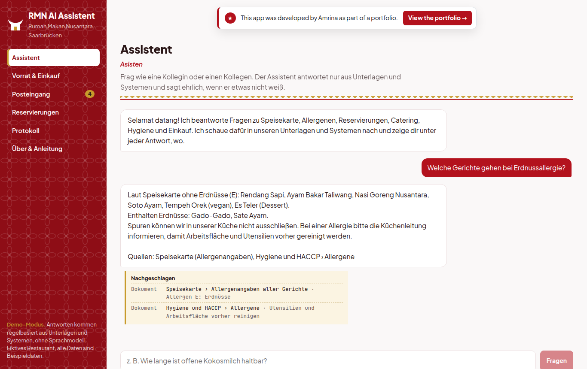

# RMN AI Assistent

[](https://github.com/sayamrina/rmn-ai-assistent/actions/workflows/ci.yml)

**Project 2026** · [Live app](https://rmn-ai-assistent.onrender.com/) · [Project page](https://sayamrina.github.io/rmn-ai-assistent/) · [Portfolio](https://sayamrina.github.io/)

An AI assistant for the staff of **Rumah Makan Nusantara**, an Indonesian restaurant in Saarbrücken (personal project). It answers questions from the restaurant's own documents, looks up stock and reservations through an API, prepares supplier orders and turns guest e-mails into checked reply drafts. It never invents an answer, and nothing is sent or booked before a person approves. The interface is in German, like the restaurant's team.



## What it does

| Area | What staff can do | How it works |
|---|---|---|
| **Assistant (chat)** | Ask about dishes, allergens, opening hours, catering, hygiene rules, stock or free tables | Retrieval-augmented generation over the restaurant's documents (BM25), tool calls into the stock and reservation systems. Every answer shows a "Nota" with the document sections and system records it used; without a source it says it does not know. |
| **Vorrat & Einkauf** | See stock against minimum levels, book goods in and out, create a supplier order | REST API over the stock tables. Order quantities (up to twice the minimum, full packs), minimum order values and the 500 € approval limit are computed in code. |
| **Posteingang** | Let the assistant read a guest e-mail and draft the answer | The model (or, in demo mode, a parser) extracts what the guest wants; opening hours, capacity, allergens and catering prices are checked in code. Approving the draft books the reservation. |
| **Reservierungen, Protokoll** | Check the reservation book; see who triggered what | Every answer, booking, order and approval is written to an audit log. |

## Language model of your choice

The app talks to any **OpenAI-compatible** endpoint:

| `LLM_PROVIDER` | Runs with |
|---|---|
| `demo` (default) | no language model: rule-based answers from the same tools and documents, free and deterministic |
| `openai` | OpenAI API (`OPENAI_API_KEY`, `LLM_MODEL`, default `gpt-4o-mini`) |
| `local` | a self-hosted model, e.g. Ollama, vLLM or LM Studio, at `LLM_BASE_URL`; restaurant data does not leave your own server |

Public demos are protected by a per-session hourly limit and a daily limit on model calls.

## Design decisions

- **The model never decides business rules.** Stock levels, order quantities, opening hours, seat capacity and prices come from code and data; the model only chooses which tool to call and phrases the answer.
- **No answer without a source.** Below a retrieval threshold the assistant refuses instead of guessing. Allergen answers are read directly from the allergen codes on the menu.
- **A person approves.** Supplier orders and replies to guests are drafts until someone releases them; orders over 500 € need management approval.
- **Only known tools.** The model can call six read-only tools; anything else is rejected.

## Run it

```bash
# backend (Python 3.12)
python -m venv .venv && .venv/bin/pip install -r backend/requirements-dev.txt
cd backend && ../.venv/bin/pytest -q                       # 16 tests
../.venv/bin/uvicorn app.main:app --host 127.0.0.1 --port 8095

# frontend (Node 22), builds into backend/static
cd frontend && npm ci && npm run build

# or everything in one container
docker build -t rmn-ai-assistent . && docker run -p 8000:8000 rmn-ai-assistent
```

With a model: `LLM_PROVIDER=openai OPENAI_API_KEY=... uvicorn app.main:app`, or `LLM_PROVIDER=local LLM_BASE_URL=http://localhost:11434/v1 LLM_MODEL=qwen2.5:7b` for Ollama.

## Structure

```
backend/app/
  knowledge/     restaurant documents (menu with allergens, opening hours, catering, HACCP, purchasing)
  knowledge.py   BM25 retrieval with sources
  tools.py       stock, purchase orders, availability, reservations (business rules) + tool schemas
  assistant.py   chat: tool-calling loop with the model, rule-based demo mode, receipts
  inbox.py       guest e-mails -> extraction -> checks -> reply draft -> approval
  db.py          SQLite schema and sample data
  main.py        REST API, rate limits, serves the frontend
frontend/src/    React + TypeScript (Assistent, Vorrat & Einkauf, Posteingang, Reservierungen, Protokoll, Über)
```

Rumah Makan Nusantara, its menu, suppliers, guests and e-mails are sample data from a personal project.

This app was built by Amrina, with AI as a supporting tool for coding.
